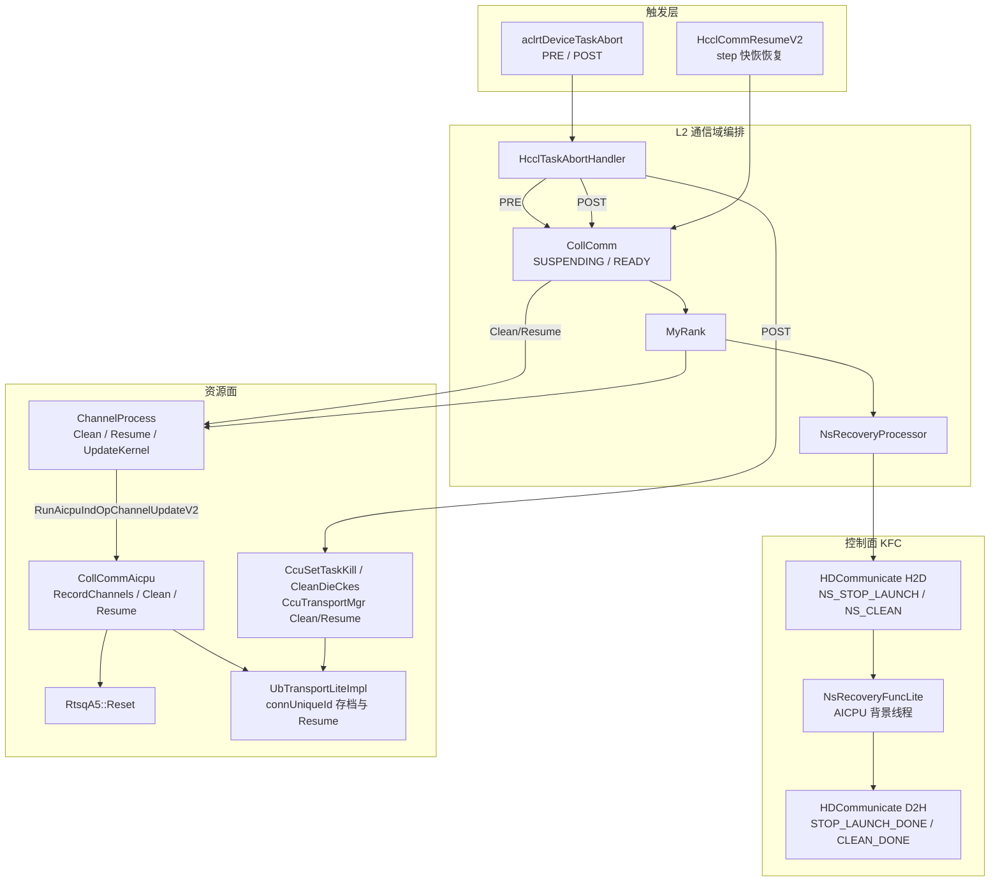
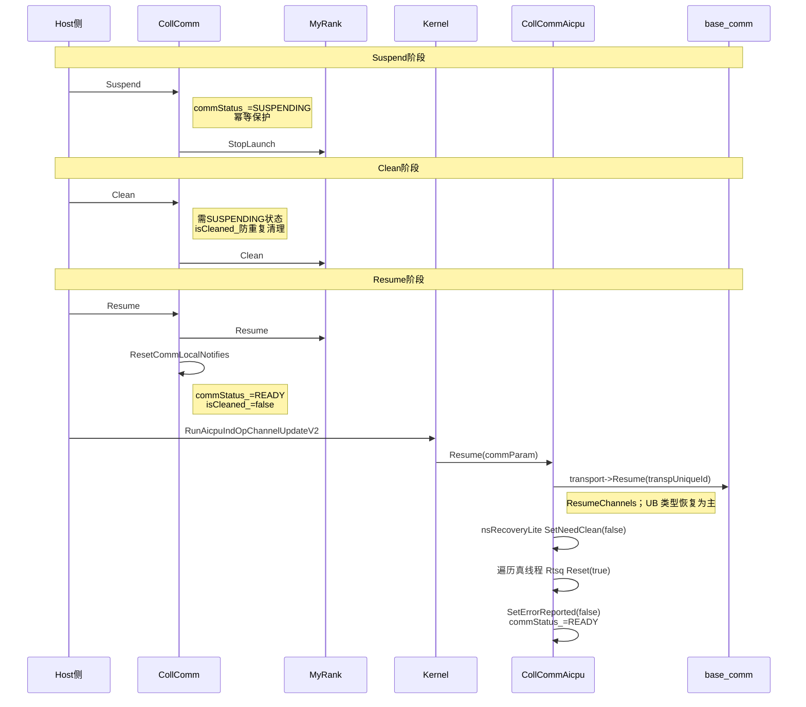

# HCOMM 仓库 A5 N 秒快恢流程分析

> **分析对象**：[cann/hcomm](https://gitcode.com/cann/hcomm)（Huawei Communication，HCCL 通信基础库）  
> **关注点**：Ascend 950 / A5 平台上的 **N 秒快恢**（代码中普遍记为 **NsRecovery**）  
> **文档性质**：基于开源 master 代码与模块文档的结构化解读，非厂商对外规格说明。

---

## 1. 概述

### 1.1 什么是 N 秒快恢

**N 秒快恢**指在集群或设备出现异常（如片上内存 UCE、流任务需中止等）时，在 **不退出 Host 进程、不销毁整通信域** 的前提下，在 **秒级** 时间内完成：

1. **挂起（Suspend）** — 停止新的通信算子下发与执行；  
2. **清理（Clean）** — 释放或复位 Host / Device 侧中断态资源与链路；  
3. **恢复（Resume）** — 重建链路、复位队列与 notify，通信域回到可工作状态。

工程上通过 **固定超时**（如 KFC 等待约 10s）、**轮询间隔**（如 TS abort 状态约 5ms）等约束，把恢复时间控制在「秒级」而非完整 `HcclCommDestroy` + 重 Init。

### 1.2 A5 在仓内的含义

- **A5** 对应 **Ascend 950** 系列（如 `Ascend950PR`）。  
- 设备分支：`src/legacy/ascend950/`；新通信域路径在 **≥950** 时走 `CollCommAicpu` / `CollCommAicpuKernelAdpt`，而非 legacy `AicpuHcclProcess`（见 `coll_comm_aicpu_kernel.cc` 中 `EqualToOrGreaterThan950()` 分派）。

### 1.3 与公开 API 的关系

| API / 机制 | A5 支持情况（文档/代码摘要） |
|------------|------------------------------|
| `aclrtDeviceTaskAbort` + 注册回调 | 快恢 **挂起/清理** 的主要触发路径（`HcclTaskAbortHandler`） |
| `HcclCommResume` / `HcclCommResumeV2` | A5 恢复入口存在（`op_base_v2.cc`） |
| `HcclCommSuspend` | 公开文档对 950 标为 **不支持**；`HcclCommSuspendV2` 在 V950 实现中直接返回 not support，实际挂起多走 **Abort PRE 阶段 → `CollComm::Suspend`** |

---

## 2. HCOMM 分层与快恢模块地图

```text
hcomm/
├── src/coll_communicator_mgr/          # L2 集合通信域管理（快恢编排核心）
│   ├── communicator/                   # CollComm / CollCommAicpu
│   └── dfx/ns_recovery/                # NsRecoveryProcessor / NsRecoveryFuncLite
├── src/base_comm/                      # L3 通道、传输、线程（Clean/Resume）
│   └── resources/endpoint_pairs/channels/
└── src/legacy/ascend950/               # A5 特性：RtsqA5、UB/CCU、CommunicatorImpl
```

| 层级 | 模块 | N 秒快恢职责 |
|------|------|----------------|
| 触发 | `dfx/ns_recovery/task_abort_handler.*` | 对接 ACL `aclrtDeviceTaskAbort` PRE/POST |
| 编排 | `communicator/coll_comm.*` | 通信域状态机：Suspend / Clean / Resume |
| Rank | `resource_mgr/local/my_rank/my_rank.*` | 委托 `NsRecoveryProcessor` + `ChannelProcess` |
| 控制面 | KFC + `HDCommunicate` | Host↔AICPU 命令：`NS_STOP_LAUNCH`、`NS_CLEAN` 与状态回传 |
| Device 域 | `communicator/device/coll_comm_aicpu.*` | 通道表、transport Clean/Resume、Rtsq 复位 |
| 守护 | `dfx/ns_recovery/aicpu/ns_recovery_func_lite.*` | AICPU 背景线程处理 NS 命令 |
| 资源 | `base_comm` `ChannelProcess` | Host 侧通道 Clean / Resume / UpdateKernel |
| A5 特性 | `rtsq_a5.cc`、`ub_transport_lite_impl`、CCU | SQ 复位、uniqueId 存档、CCU TaskKill |

模块详解与时序图可参考仓内：`src/coll_communicator_mgr/communicator/communicator.md`（章节「N秒快恢流程」）。

---

## 3. 流程框架：三阶段状态机

官方模块文档将快恢归纳为 **`Suspend → Clean → Resume`**，Host 以 `CollComm` 为中心，Device 以 `CollCommAicpu` + 背景守护协同。

### 3.1 总体架构图



### 3.2 文档级时序（Suspend / Clean / Resume）

以下与 `communicator.md` 中 Mermaid 时序一致，便于与源码对照：



---

## 4. 分阶段行为说明

### 4.1 Suspend（停下发）

| 环节 | 行为 |
|------|------|
| **触发** | `HcclTaskAbortHandler::ProcessTaskAbortCallback` 在 `ACL_RT_DEVICE_TASK_ABORT_PRE` 对已注册 `CollComm` 调用 `Suspend()` |
| **`CollComm::Suspend`** | 置 `commStatus_ = SUSPENDING`（幂等）；可选向 DPU 共享内存写 abort 标志，打断 `WaitResponse`；调用 `myRank_->StopLaunch()` |
| **`NsRecoveryProcessor::StopLaunch`** | 经 KFC H2D 发送 `KfcCommand::NS_STOP_LAUNCH`，轮询 D2H 直至 `KfcStatus::STOP_LAUNCH_DONE`（`WAIT_CMD_TIMEOUT` 默认 10s） |
| **AICPU 守护** | `NsRecoveryFuncLite::HandleStopLaunch`：读命令 → 清遗留状态 → `SetNeedClean(true)` → 写 `STOP_LAUNCH_DONE` |
| **算子侧感知** | `CollCommAicpu::CheckIndOpExecStatus` 在 SUSPENDING 时返回 `HCCL_E_SUSPENDING` |

### 4.2 Clean（清状态）

| 环节 | 行为 |
|------|------|
| **触发** | Abort **POST**：`CcuSetTaskKill` → 各通信域 `Clean()` → `CcuSetTaskKillDone` + `CcuCleanDieCkes`（`task_abort_handler.cc`） |
| **`CollComm::Clean`** | 要求处于 SUSPENDING；`isCleaned_` 防重复；`myRank_->Clean()` |
| **Host `MyRank::Clean`** | 先 `ChannelProcess::ChannelClean`（全通道）；再 `NsRecoveryProcessor::Clean`（确认 `STOP_LAUNCH_DONE` 后下发 `NS_CLEAN`，等 `CLEAN_DONE`） |
| **AICPU** | `HandleClean` → `StreamClean`（`halTsdrvCtl` 查询 TS abort 至 `APP_ABORT_KILL_FINISH`）→ `CollCommAicpu::Clean()` 遍历 `channelHandleList_` 调用 transport `Clean()` |
| **A5 资源** | `UbTransportLiteImpl` 保留 `connUniqueIdVec` / `connVec` 等，供 Resume 重建；CCU 路径使用 `CcuTransportMgr::Clean()`（legacy `CommunicatorImpl` 并行逻辑） |

### 4.3 Resume（恢复）

| 环节 | 行为 |
|------|------|
| **入口** | 用户侧：`HcclCommResumeV2` → `HcclCommunicator::Resume()`；新 L2 路径：`CollComm::Resume()` |
| **`CollComm::Resume`** | `myRank_->Resume()`；`commEngineResMgr_->ResetCommLocalNotifies()`；`commStatus_ = READY`，`isCleaned_ = false` |
| **Host `MyRank::Resume`** | `ChannelProcess::ChannelResume`（并发 Resume + 轮询链路 READY）；`NsRecoveryProcessor::Resume` → `ChannelUpdateKernelLaunch` |
| **Device Kernel** | `RunAicpuIndOpChannelUpdateV2`（≥950）→ `CollCommAicpu::Resume`：`ResumeChannels` 解析 uniqueId 并 `impl->Resume()`；真线程 `RtsqA5::Reset(true)` |
| **legacy A5** | `CommunicatorImpl::Resume` 在 CCU / AICPU_TS / AIV 模式下调用 `collService->Resume()`（如 `CollServiceAiCpuImpl` 批建链、打包传输数据等） |

---

## 5. 主要能力清单

hcomm 为 A5 N 秒快恢提供的能力可归纳为：

1. **通信域级状态机**  
   `CollComm` 的 Suspend / Clean / Resume 与 `HcclCommStatus`；可与 `HcclCommStatePhase`（RESUME_PRE / RESUME_POST）回调配合（step 快恢）。

2. **运行时任务终止集成**  
   `CollCommMgr::RegisterCollComm` 将通信域注册到 `HcclTaskAbortHandler`，统一响应设备级 **Task Abort**，实现多通信域批量挂起/清理（带超时）。

3. **Host–Device 轻量命令通道（KFC）**  
   `HDCommunicate` 传递 `KfcCommand` / `KfcExecStatus`，避免为快恢单独拆进程；Device 侧 `NsRecoveryLite` + 守护 `NsRecoveryFuncLite` 异步消费命令。

4. **通道与传输的「清理 + 快重建」**  
   - Host：`ChannelProcess::ChannelClean` / `ChannelResume` / `ChannelUpdateKernelLaunch`  
   - Device：`RecordChannels` 建档 → `Clean` → 凭 **序列化 transport uniqueId** `Resume`  
   - 文档注明 Device `ResumeChannels` 当前以 **UB 类型** 恢复实现为主。

5. **AICPU 执行面复位（A5）**  
   `RtsqA5::Reset`：清 SQ head/tail、pending SQE、本地 SQE 缓冲等，避免挂起后残留任务继续执行。

6. **CCU / 算子加速路径**  
   POST 阶段 TaskKill、清 CKE；`CcuTransportMgr::Clean` / `Resume` 与 `ccu_comp` 上 TaskException 相关接口。

7. **DFX 与防重复上报**  
   Resume 时 `SetErrorReported(false)`；`TaskException`、`StreamTaskMonitor` 等与 `CollCommAicpuMgr::InitBackGroundThread` 一并注册。

8. **秒级工程约束**  
   KFC 同步默认 10s 超时；`NsRecoveryFuncLite::DeviceQuery` 5ms 级轮询；与「N 秒」产品目标一致，而非分钟级整域重建。

---

## 6. A5 双轨实现说明

读仓时需注意 **新 L2 路径** 与 **legacy ascend950** 并存：

| 路径 | 典型场景 | 快恢核心类型 |
|------|----------|----------------|
| **新 HCOMM L2** | `CollComm` full/simple 模式、独立算子 AICPU 域 | `CollComm`、`NsRecoveryProcessor`、`CollCommAicpu` |
| **legacy CommunicatorImpl** | `HcclCommunicator`、部分 CCU 图模式 / 旧入口 | `CommunicatorImpl::{Suspend,Clean,Resume}`、`CollServiceDeviceMode` |

二者在 **KFC 命令语义**（`NS_STOP_LAUNCH` / `NS_CLEAN` 与 DONE 状态）上高度同构；新域逐步以 L2 为中心收敛。对外 **Resume** 在 V950 走 `HcclCommResumeV2`；**Suspend** 对用户 API 可能不可用，但实际仍可通过 **Abort 回调** 进入 `CollComm::Suspend`。

---

## 7. 关键源码索引

| 主题 | 路径 |
|------|------|
| 模块说明与时序 | `src/coll_communicator_mgr/communicator/communicator.md` |
| Host 三阶段 API | `src/coll_communicator_mgr/communicator/coll_comm.cc` |
| Host KFC 处理 | `src/coll_communicator_mgr/dfx/ns_recovery/ns_recovery.cc` |
| Abort 回调 | `src/coll_communicator_mgr/dfx/ns_recovery/task_abort_handler.cc` |
| AICPU 守护 | `src/coll_communicator_mgr/dfx/ns_recovery/aicpu/ns_recovery_func_lite.cc` |
| Device Resume/Clean | `src/coll_communicator_mgr/communicator/device/coll_comm_aicpu.cc` |
| ≥950 Kernel 分派 | `src/coll_communicator_mgr/communicator/device/c_adpt/coll_comm_aicpu_kernel.cc` |
| Host 通道 | `src/base_comm/resources/endpoint_pairs/channels/channel_process.cc` |
| A5 RTSQ | `src/legacy/ascend950/unified_platform/resource/stream/aicpu/rtsq_a5.cc` |
| UB 快恢资源 | `src/legacy/ascend950/unified_platform/resource/transport/aicpu/ub_transport_lite_impl.h` |
| legacy 通信域快恢 | `src/legacy/ascend950/framework/communicator/communicator_impl.cc` |
| A5 Resume 入口 | `src/legacy/ascend950/framework/entrance/op_base/op_base_v2.cc` |
| KFC 命令枚举（legacy 头） | `src/legacy/ascend910/pub_inc/aicpu_operator_pub.h`（`NsStopLaunch` 等） |

---

## 8. 结论

**A5 的 N 秒快恢在 hcomm 中是一套分层框架**：以 **运行时 Task Abort** 与 **`CollComm` 三阶段状态机** 为编排核心，以 **KFC 共享内存** 完成 Host–AICPU 控制面同步，以 **`ChannelProcess` + Lite Transport（uniqueId Resume）+ `RtsqA5` 复位 + CCU TaskKill** 完成资源面清理与快重建。其设计目标是 **进程内、秒级、通信域可继续使用**，区别于销毁通信域后完整重新初始化。

---

## 9. 修订记录

| 日期 | 说明 |
|------|------|
| 2026-11-12 | 初版：基于 gitcode.com/cann/hcomm 开源树梳理 |
